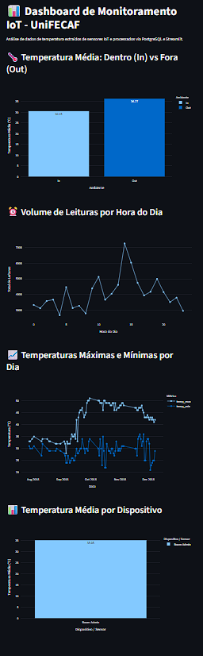
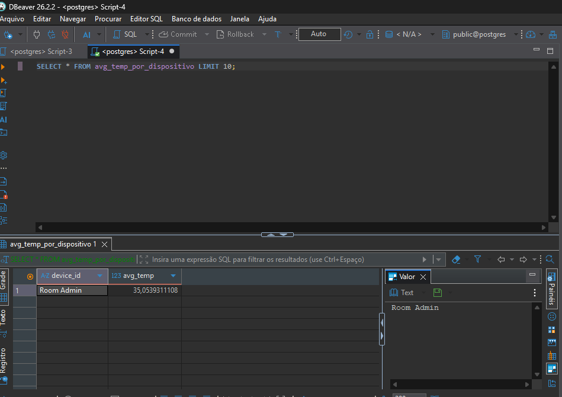

# 📊 Pipeline de Big Data & Dashboard IoT — UniFECAF

Projeto de Engenharia e Análise de Dados desenvolvido para a UniFECAF, focado na ingestão automatizada, processamento relacional com Docker/PostgreSQL 15 e visualização interativa de telemetria de sensores IoT.

---

## 🚀 Sobre o Projeto
O objetivo deste pipeline é processar um grande volume de dados de temperatura coletados de dispositivos IoT (*Temperature Readings: IoT Devices*, contendo cerca de 97 mil registros obtidos no [Kaggle](https://www.kaggle.com)). A arquitetura divide-se em:
1. **Infraestrutura em Contêineres:** Banco de dados PostgreSQL (versão 15) configurado via Docker Compose para garantir estabilidade.
2. **Camada de Ingestão e Processamento:** Scripts em Python utilizando Pandas e SQLAlchemy.
3. **Modelagem Analítica:** 4 Views SQL desenvolvidas no PostgreSQL para otimizar consultas.
4. **Visualização de Dados (BI):** Dashboard interativo construído com Streamlit e Plotly.

---

## 🛠️ Tecnologias Utilizadas
- **Linguagem:** Python (Pandas, Plotly, SQLAlchemy)
- **Banco de Dados:** PostgreSQL 15
- **Contêineres:** Docker & Docker Compose (`postgres-iot`)
- **Visualização:** Streamlit
- **Controle de Versão:** Git & GitHub

---

## 📂 Estrutura de Pastas do Repositório
- `src/`: Contém os scripts Python (`dashboard.py` e `ingest.py`).
- `sql/`: Contém o script `views.sql` com as definições das views relacionais.
- `docs/`: Contém as capturas de tela do sistema e do dashboard.
- `docker-compose.yml`: Arquivo de orquestração do contêiner PostgreSQL.
- `data/`: Diretório destinado ao conjunto de dados em CSV.

---

## ⚙️ Modelagem Analítica (Views SQL)
Foram implementadas as seguintes views no PostgreSQL para otimizar a performance do dashboard:
1. `avg_temp_por_dispositivo`: Média de temperatura consolidada por identificador de sensor.
2. `leituras_por_hora`: Contagem volumétrica de leituras agregada por hora ao longo do dia.
3. `temp_max_min_por_dia`: Mapeamento das oscilações térmicas máximas e mínimas diárias.
4. `temp_por_ambiente`: Comparativo de temperatura média segmentado por ambiente (*Inside vs Outside*).

---

## 📸 Capturas de Tela (Dashboard & Banco de Dados)

### Dashboard Interativo (Streamlit)


### Modelagem de Dados e Views no PostgreSQL (DBeaver)


---

## 💻 Instruções de Execução

### 1. Clonar o Repositório
```bash
git clone [https://github.com/lucasdsntts/Pipeline-de-Dados-com-IoT-e-Docker.git](https://github.com/lucasdsntts/Pipeline-de-Dados-com-IoT-e-Docker.git)
cd Pipeline-de-Dados-com-IoT-e-Docker